# 智灵试题管理系统 用户手册

> 版本号：V1.0.0　｜　著作权人：林业福　｜　编写日期：2026 年 11 月 18 日

## 目录

- [第1章 引言](#第1章-引言)
  - [1.1 编写目的](#11-编写目的)
  - [1.2 软件简介](#12-软件简介)
  - [1.3 适用对象](#13-适用对象)
- [第2章 运行环境与安装](#第2章-运行环境与安装)
  - [2.1 硬件环境](#21-硬件环境)
  - [2.2 软件环境](#22-软件环境)
  - [2.3 安装与卸载](#23-安装与卸载)
  - [2.4 启动与授权](#24-启动与授权)
- [第3章 软件界面总览](#第3章-软件界面总览)
  - [3.1 主界面布局](#31-主界面布局)
  - [3.2 导航栏功能入口](#32-导航栏功能入口)
- [第4章 题库管理](#第4章-题库管理)
  - [4.1 题库页面](#41-题库页面)
  - [4.2 管理题库分类](#42-管理题库分类)
  - [4.3 添加题库](#43-添加题库)
  - [4.4 编辑题库](#44-编辑题库)
  - [4.5 置顶与收藏](#45-置顶与收藏)
  - [4.6 搜索题库](#46-搜索题库)
  - [4.7 删除题库](#47-删除题库)
- [第5章 试题管理](#第5章-试题管理)
  - [5.1 试题页面](#51-试题页面)
  - [5.2 查看试题列表](#52-查看试题列表)
  - [5.3 搜索与筛选试题](#53-搜索与筛选试题)
  - [5.4 试题录入](#54-试题录入)
  - [5.5 快捷录入](#55-快捷录入)
  - [5.6 编辑、发布与删除试题](#56-编辑发布与删除试题)
  - [5.7 批量操作](#57-批量操作)
- [第6章 试题导入与导出](#第6章-试题导入与导出)
  - [6.1 批量导入试题](#61-批量导入试题)
  - [6.2 导出试题](#62-导出试题)
- [第7章 刷题与答卷](#第7章-刷题与答卷)
  - [7.1 刷题流程简述](#71-刷题流程简述)
  - [7.2 创建试卷](#72-创建试卷)
  - [7.3 答题](#73-答题)
  - [7.4 交卷与查看结果](#74-交卷与查看结果)
  - [7.5 答卷记录](#75-答卷记录)
- [第8章 随记](#第8章-随记)
  - [8.1 添加随记](#81-添加随记)
  - [8.2 查看、编辑与删除](#82-查看编辑与删除)
  - [8.3 搜索随记](#83-搜索随记)
- [第9章 首页数据概览与数据诊断](#第9章-首页数据概览与数据诊断)
  - [9.1 首页数据概览](#91-首页数据概览)
  - [9.2 数据诊断](#92-数据诊断)
- [第10章 设置与数据安全](#第10章-设置与数据安全)
  - [10.1 数据备份](#101-数据备份)
  - [10.2 数据还原](#102-数据还原)
  - [10.3 数据存放与隐私](#103-数据存放与隐私)
  - [10.4 授权信息](#104-授权信息)
- [第11章 常见问题](#第11章-常见问题)
- [附录 版本说明](#附录-版本说明)

---

## 第1章 引言

### 1.1 编写目的

本手册用于指导用户安装、使用智灵试题管理系统（V1.0.0），说明软件的运行环境、各功能模块的操作方法以及常见问题的处理方式，帮助用户快速上手。

### 1.2 软件简介

智灵试题管理系统（以下简称“智灵题库”）是一款运行于 Windows 系统的试题管理与刷题软件，面向考证、试题收纳、笔试等场景。用户可以建立多个题库，录入或批量导入5种题型，随时练习与复习，并通过首页的数据统计了解题库情况。为保障用户试题和数据安全，本软件将数据保存在用户本机，不上传服务器。用户需要自行定期备份，防止硬件故障造成不必要的损失。

### 1.3 适用对象

- 备考各类资格证书、职业考试的自学者

- 需要整理、归类并反复练习试题的学习者

- 需要管理和导出题库资料的教学与培训人员

## 第2章 运行环境与安装

### 2.1 硬件环境

| **项目**     | **最低要求** | **推荐配置**     |
|--------------|--------------|------------------|
| 处理器       | i3           | i3及以上         |
| 内存         | 8 GB         | 8 GB 及以上      |
| 硬盘可用空间 | 500MB        | 500MB及以上      |
| 显示分辨率   | 1366×768     | 1920×1080 及以上 |

### 2.2 软件环境

- 操作系统：Windows 10 / Windows 11（64 位）

- Microsoft Edge WebView2 运行时：用于显示试题编辑器。Windows 11 及较新的 Windows 10 通常已预装；未安装时，软件启动会给出提示并引导用户到官方页面安装。

- 网络：用于授权状态校验，其余功能可离线使用。

### 2.3 安装与卸载

#### 2.3.1 安装

1.  打开 Microsoft Store，搜索“智灵题库”，进入应用页面。

2.  点击“获取”或“购买”，等待下载安装完成。

3.  安装完成后，按键盘上的 Win 键打开“开始”菜单，在“最近添加”中找到“智灵题库”，点击即可启动。


*图 2-1 开始菜单中的应用图标*

为方便使用，可以将“智灵题库”固定到任务栏：在“开始”菜单中右键点击“智灵题库”，选择“更多 → 固定到任务栏”（图 2-2）。

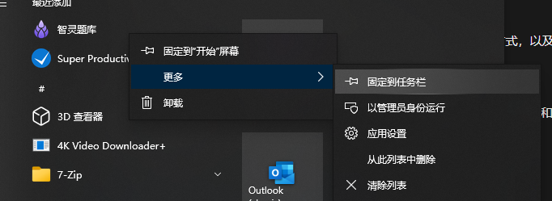

*图 2-2 将智灵题库固定到任务栏*

#### 2.3.2 卸载

可以用以下任一方式卸载“智灵题库”：

- 通过搜索卸载：点击 Windows 左下角的搜索按钮，输入“智灵题库”，在搜索结果右侧的菜单中选择“卸载”（图 2-3）。

- 通过“开始”菜单卸载：在“开始”菜单中右键点击“智灵题库”，选择“卸载”（见图 2-2）。

- 通过控制面板卸载：在“控制面板”中找到“智灵题库”，选择卸载；也可以在“设置 → 应用 → 应用和功能”中找到“智灵题库”，点击“卸载”。

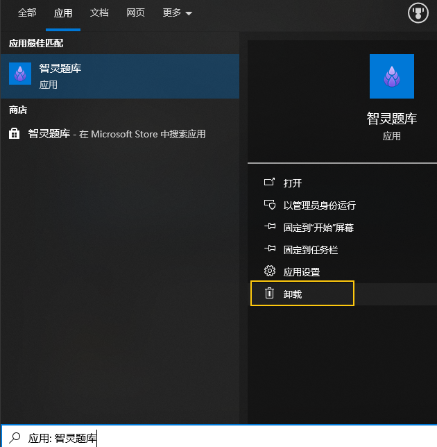

*图 2-3 通过搜索卸载智灵题库*

卸载本身不会清除用户数据（数据库和图片）。但为防止意外，建议卸载前先使用软件的备份功能导出数据（见第10章）。

### 2.4 启动与授权

通过 Windows 应用商店（Microsoft Store）下载和安装的用户，可以试用软件一段时间。

- 试用期内：可以正常使用软件。

- 试用到期后：无法进入软件，需要前往微软应用商店购买；购买成功后，即可继续使用软件。

- 查看授权情况：点击软件右上角的设置按钮（齿轮图标），选择“关于授权”，即可查看软件的授权情况（图 2-5，详见 10.4）。

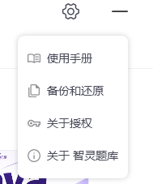

*图 2-5 设置菜单中的“关于授权”*

## 第3章 软件界面总览

### 3.1 主界面布局

软件主界面左侧为导航栏，右侧为内容区。点击导航栏中的功能入口，内容区会切换到对应页面。软件启动后默认显示“首页”。右上角提供设置、最小化、最大化和关闭按钮。

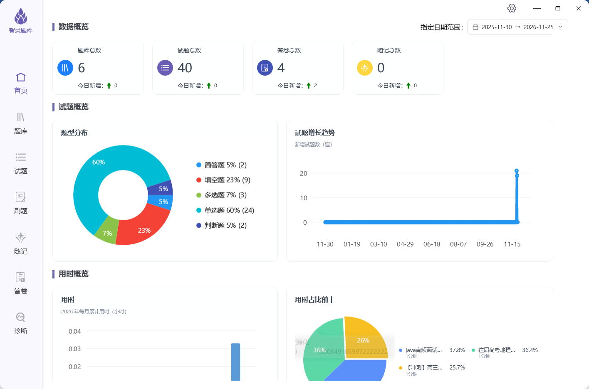

*图 3-1 主界面（首页）：左侧为导航栏，右侧为内容区*

### 3.2 导航栏功能入口

| **入口** | **说明**                                                                     |
|----------|------------------------------------------------------------------------------|
| 首页     | 数据概览：题库、试题、答卷、随记的数量统计，题型分布、试题增长趋势和用时统计 |
| 题库     | 建立、编辑和整理题库及题库分类                                               |
| 试题     | 查看、筛选、录入和编辑试题，导入与导出试题                                   |
| 刷题     | 选择题库、设置条件，组卷后在线刷题                                           |
| 随记     | 记录学习笔记与知识点、未入库的试题、思路、灵感、构思等                       |
| 答卷     | 查看练习生成作答记录                                                         |
| 诊断     | 自动检查试题和题库中缺失或异常的数据，并定位问题项                           |

## 第4章 题库管理

### 4.1 题库页面

点击导航栏“题库”进入题库页面。页面分为左右两部分：左侧是“题库分类”，右侧是“全部题库”（或当前所选分类下的题库），添加题库在页面右上角有按钮。


*图 4-1 题库页面*

#### 4.1.1 题库分类列表

左侧分类列表分为两类：

- 系统分类：“全部题库”显示所有题库，“收藏夹”显示已收藏的题库。

- 自建分类：用户自己创建的分类（图中的“编程”“高三”“考证”）。

每个分类右侧的数字表示该分类下的题库数量。点击分类，右侧立即切换为该分类下的题库。

#### 4.1.2 题库卡片

每个题库以卡片形式显示，包含：

- 封面图片，左上角的标签显示所属分类

- 题库名称与简介

- 四个操作按钮：收藏、置顶、编辑、删除，分别对题库进行操作。其中 编辑按钮，会打开窗体，可以对封面图片的大小、显示区域进行调整，也可以改变题库所在的分类。

- 创建日期与试题数

### 4.2 管理题库分类

#### 4.2.1 新建分类

1.  在左侧“题库分类”上方的输入框中输入分类名称。点击输入框右侧的“+新建分类”。 新分类出现在分类列表中。


#### 4.2.2 分类的置顶、上移、重命名与删除

对分类列表中的自建分类，可打开其操作菜单，菜单包含四项：

| **菜单项** | **说明**                     |
|------------|------------------------------|
| 置顶       | 将该分类移到分类列表的最前面 |
| 上移       | 将该分类在列表中向上移动一位 |
| 重命名     | 修改分类名称                 |
| 删除       | 删除该分类                   |


*图 4-2 分类操作菜单*

### 4.3 添加题库

点击页面右上角“添加题库”，弹出“题库信息”窗口。窗口左侧用于设置封面，右侧用于填写题库信息。封面的图片可以进行缩放、移动、删除操作。


*图 4-3 “题库信息”窗口（添加题库）*

#### 4.3.1 设置封面

1.  点击左侧“点击选择封面图片”，选择一张本地图片。

2.  选好之后，可以拖动图片，调整题库卡片上实际显示的区域。

封面图片为必选项：未选择图片时，窗口底部会以红字提示“需要设置一张图片来展示题库”。

#### 4.3.2 填写题库信息

| **项目**            | **说明**                       |
|---------------------|--------------------------------|
| 题库名              | 题库的名称                     |
| 分类                | 从下拉列表中选择题库所属的分类 |
| 简介                | 对题库内容的简要介绍           |
| 创建日期 / 最后日期 | 由系统自动记录，不可修改       |

填写完成后点击“新建”，题库创建完成，并显示在题库页面中。

### 4.4 编辑题库

点击题库卡片上的“编辑”按钮，会弹出编辑框，可以修改题库的名称、分类、简介和封面。

### 4.5 置顶与收藏

- 置顶：把常用题库固定在当前列表的最前面，方便快速找到。

- 收藏：把题库加入“收藏夹”分类，之后可在“收藏夹”中集中查看。

### 4.6 搜索题库

在页面上方的搜索框中输入关键词，点击“查询”，即可在当前分类目录内查找匹配的题库。

### 4.7 删除题库

点击题库卡片上的“删除”图标可删除该题库，如果题库内有题目，必须切换到试题板块，将对应的题库的题目清空后，才能删除题库。

## 第5章 试题管理

### 5.1 试题页面

点击导航栏“试题”进入试题页面。页面分为左右两部分：左侧是“试题分类”，用于选择要查看的题库；右侧显示所选题库中的全部试题。

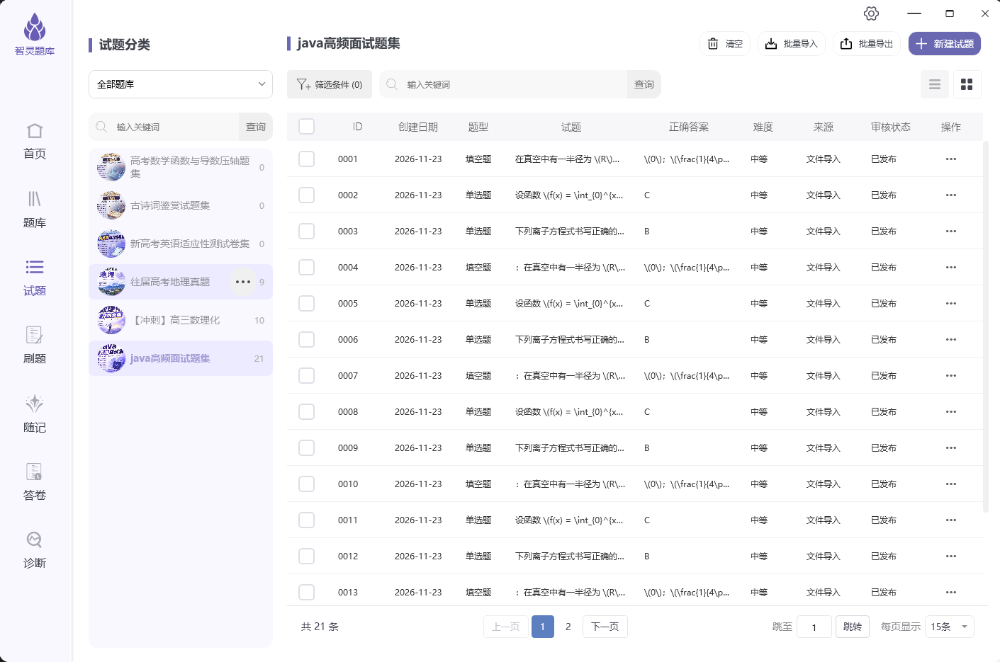

*图 5-1 试题页面（列表视图）*

#### 5.1.1 左侧：试题分类

- 顶部下拉框（默认“全部题库”）：按题库分类缩小题库范围。

- 搜索框：输入关键词后点击“查询”，按关键词查找题库。

- 题库列表：显示各题库的封面缩略图、名称和试题数量；点击某个题库，右侧切换为该题库的试题。

将鼠标移到题库条目上，条目右侧会出现“…”按钮，点击后弹出操作菜单，包含“置顶”“重命名”“删除”三项。


*图 5—2 题库条目的“…”按钮（左）与操作菜单（右）*

#### 5.1.2 右侧：试题区域

右侧顶部显示当前题库的名称，并提供以下按钮：

| **按钮** | **说明**                                              |
|----------|-------------------------------------------------------|
| 清空     | 清除当前题库中的试题                                  |
| 批量导入 | 从文件批量导入试题（见第6章），支持多种文件格式导入   |
| 批量导出 | 将试题批量导出为文件（见第6章），支持多种文件格式导出 |
| 新建试题 | 打开试题编辑器，录入一道新试题（见 5.5、5.6）         |

按钮下方是“筛选条件”按钮、搜索框和视图切换按钮（列表视图 / 卡片视图）。试题区域底部是分页栏。

### 5.2 查看试题列表

试题区域支持两种视图（列表和卡片），点击右上角的视图切换按钮即可切换。

#### 5.2.1 列表视图

列表视图以表格形式显示试题，便于快速浏览和对比。

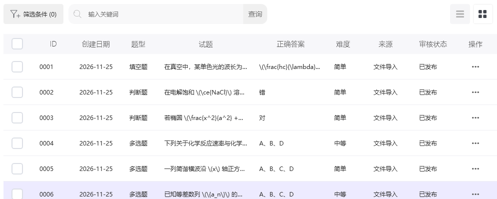

注意：试题和正确答案 列显示的是的原始文本，其中的数学公式会以公式代码的形式显示（见图 9-5）。这是正常的公式代码，不是错误，也不影响刷题页面的公式显示。

#### 5.2.2 卡片视图

卡片视图逐题展开显示，方便批量导入时，检查题目的显示效果。


*图 5-3 试题页面（卡片视图）*

#### 5.2.3 分页

试题区域底部是分页栏：左侧显示试题总数（如“共 21 条”），中间是“上一页”、页码和“下一页”，右侧可在“跳至”输入框中输入页码后点击“跳转”，并通过“每页显示”下拉框选择每页显示的条数（图中为 15 条，条数可调整）。

### 5.3 搜索与筛选试题

试题区域上方提供两种方式查找试题：

- 搜索：在搜索框输入关键词，点击“查询”，查找匹配的试题。

- 筛选条件：点击“筛选条件”按钮，设置筛选项。按钮旁括号内的数字表示当前已启用的筛选条件数量，（0）表示未设置任何筛选。

### 5.4 试题录入

试题录入是在“试题编辑器”中逐题填写试题内容的方式。适合题量不大、需要精细排版（如含公式、图片、表格）的试题。

#### 5.4.1 打开试题编辑器

1.  在“试题”页面选择目标题库。

2.  点击右上角“新建试题”，弹出“试题编辑器”窗口。

3.  窗口左上角显示“编辑中” ，表示当前处于编辑状态。

编辑器顶部工具栏提供相关的操作：“编辑模式”“预览模式”切换按钮、“启用快捷录入”复选框（见 5.5）、“保存草稿”和“保存并发布”按钮。

*图 5-4 试题编辑器（编辑模式）*

#### 5.4.2 填写试题内容

“试题内容”区域用于编写题干，上方为富文本工具栏，主要功能如下：

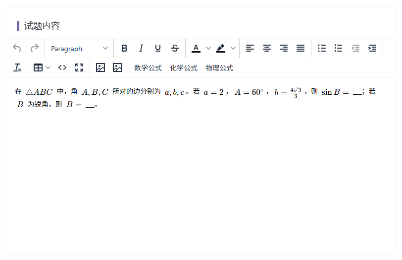

*图 5-5 试题内容编辑区（富文本工具栏）*

注意：试题内容支持插入图片并保存，但建议尽量不要使用图片，因为批量导出时不支持导出图片。

**公式输入**

题干工具栏和答案配置区（如单选题、填空题）都提供“数学公式”“化学公式”“物理公式”三个标签。点击某个标签，展开对应的公式面板；再次点击该标签（或点击面板右下角的“收起”）即可关闭面板（图 5-6）。

数学公式面板分为“基础”和“高阶”两页，按类别排列了常用的符号和公式模板，如分数、根号、上下标、绝对值、四则运算符号、希腊字母、不等号、对数等。点击面板中的某个符号或模板，即可输入到当前正在编辑的位置，随后在方框中填入具体内容。输入完成的公式会以排版后的样式显示。

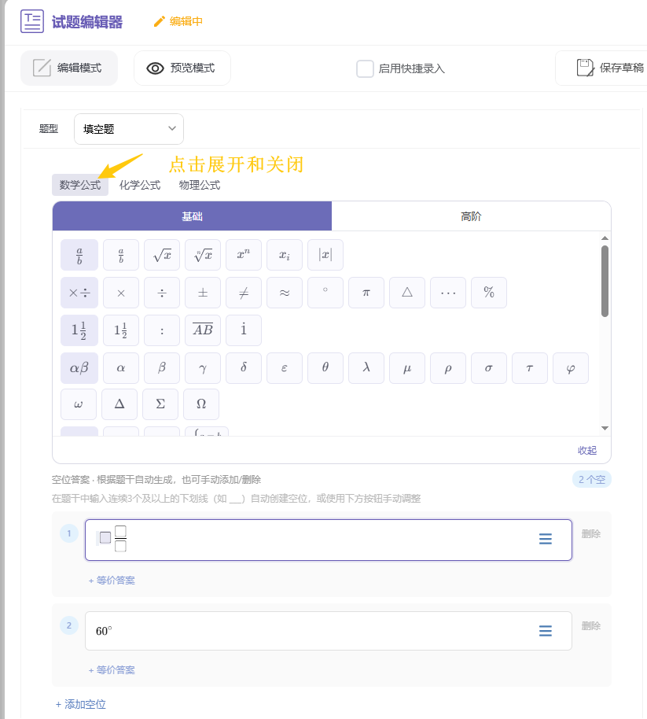

*图 5-6 公式面板（点击标签展开和关闭）*

#### 5.4.3 配置答案

“答案配置”区域位于试题内容下方。先在“题型”下拉框中选择题型（初始为“未选择”，此时区域提示“请选择一个题型”），页面随即显示该题型对应的答案设置项，按提示填写选项、正确答案和解析。

**单选题的答案配置**

选择题型“单选题”后，答案配置区默认显示 A、B、C、D 四个选项（图 5-7）：

- 在每个选项的输入框中输入选项内容，输入框内的提示说明可输入数学（katex）、物理（katex）和化学（mhchem）公式。

- 点击选项前的单选框，设定正确答案；已选中的选项显示为带勾的实心圆（图中为选项 A）。

- 点击选项右侧的“×”删除该选项；点击下方的“+ 添加选项”增加选项。

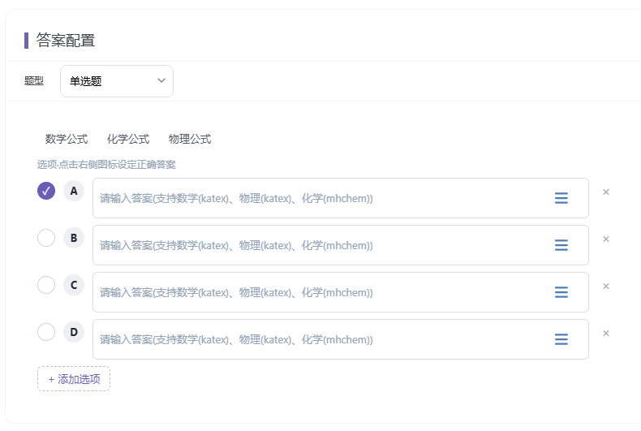

*图 5-7 答案配置（单选题）*

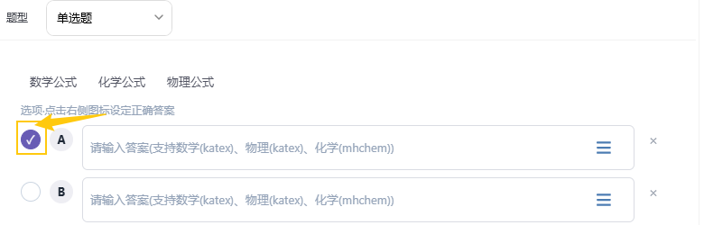

*图 5-8 点击选项前的单选框设定正确答案（多选题为复选框）*

**多选题的答案配置**

多选题的选项设置方式与单选题相同，区别是选项前显示的是复选框，点击复选框设定正确答案，可以同时勾选多个正确选项（图 5-9）。

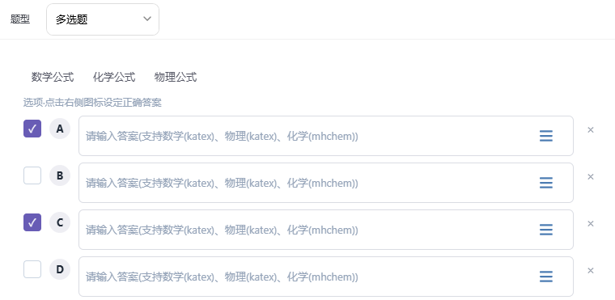

*图 5-9 答案配置（多选题，示例中勾选了 A 和 C）*

**在答案中输入公式**

需要输入公式时，有两种方式：

- 直接粘贴公式源码。

- 点击答案配置区上方的“数学公式”“化学公式”“物理公式”标签展开面板，通过面板录入（图 5-10）。


*图 5-10 点击公式标签展开面板*

**判断题的答案配置**

选择题型“判断题”后，答案配置区显示“正确”“错误”两个选项。点击选项，打勾（✔）的一项即为正确答案（图 5-11，示例中选中的是“正确”）。

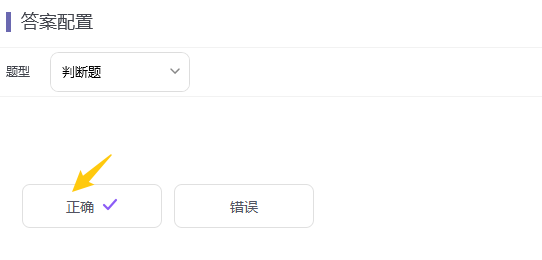

*图 5-11 答案配置（判断题）*

**填空题的答案配置**

选择题型“填空题”后，答案配置区如图 5-12 所示：

- 空位答案：根据题干自动生成，也可手动添加或删除；右上角显示空位个数（如“2 个空”）。

- 在题干中输入连续 3 个及以上的下划线（如 \_\_\_），会自动创建空位；也可以使用下方的“+ 添加空位”按钮手动增加空位。

- 每个空位对应一个答案框，左侧为序号，右侧的“删除”用于删除该空位。答案框中可以输入文字，也可以输入公式（如 √3/2、60°），输入方式与单选题、多选题相同（见“在答案中输入公式”）。

- “+ 等价答案”：为该空位添加等价答案。

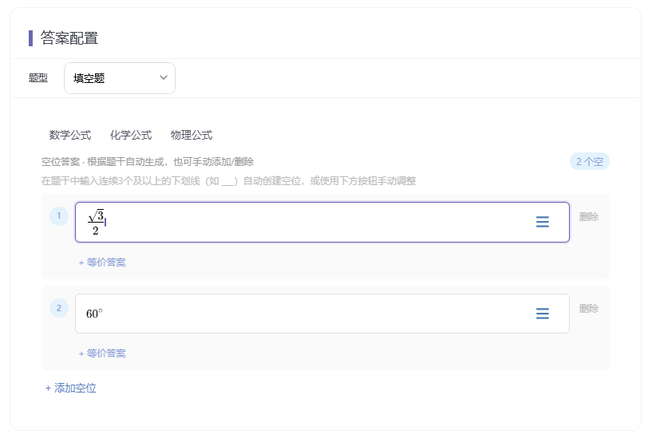

*图 5-12 答案配置（以填空题为例）*

如果修改题干后空位数量发生变化，答案配置区会用橙色文字提示“题干中的空位数量发生变化，已按原顺序对应答案，请核对是否正确”（图 5-13），请检查各空位的答案是否仍然对应。

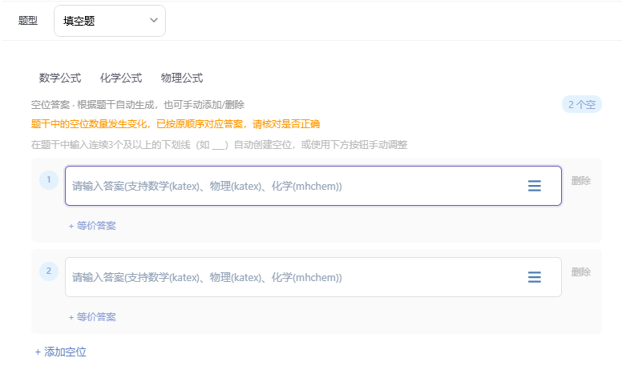

*图 5-13 空位数量变化时的提示*

**简答题的答案配置**

选择题型“简答”后，答案配置区为一个较大的文本框，支持长文本录入（图 5-14）。公式的输入方式与单选题、多选题相同（见“在答案中输入公式”）。


*图 5-14 答案配置（简答题）*

**答案解析**

“答案解析”区域位于答案配置下方，提供与试题内容相同的富文本工具栏，也可以输入公式（图 5-15）。解析不是必填项，但建议尽量填写，否则该试题会在“数据诊断”中被判定为问题项（见 9.2）。

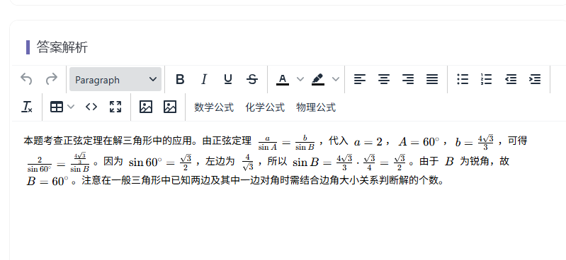

*图 5-15 答案解析*

#### 5.4.4 设置试题属性

编辑器右侧为“试题属性”面板：

| **属性**    | **说明**                                                                   |
|-------------|----------------------------------------------------------------------------|
| 状态        | 试题当前状态。新建试题默认为“草稿”                                         |
| 分值        | 该题的分值，默认为 1                                                       |
| 难度        | 试题难度，默认为“中等”，可通过下拉框修改                                   |
| 来源        | 试题来源，手动录入的试题显示为“手动创建”，从文件导入的试题显示为“文件导入” |
| 知识点      | 输入知识点名称后，点击“+”或按回车键添加，最多添加 5 个                     |
| Tag（标签） | 输入标签后，点击“+”或按回车键添加，用于归类和筛选，最多添加 5 个           |

#### 5.4.5 预览与保存

- 预览模式：点击“预览模式”查看试题的编辑效果（图 5-17）。

- 保存草稿：保存当前内容但不发布。草稿状态的试题不参与刷题，之后可继续编辑，或在试题列表中发布。

- 保存并发布：保存并将试题状态切换为发布，发布后即可参与刷题。

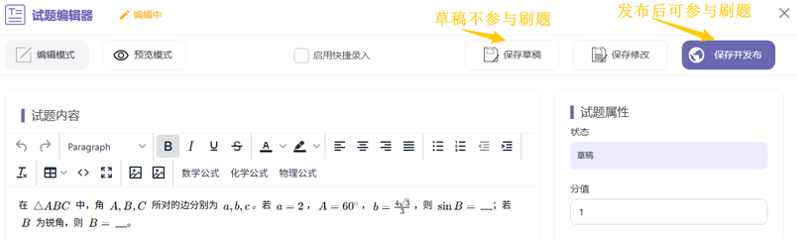

*图 5-16 保存草稿与保存并发布（草稿不参与刷题，发布后可参与刷题）*


*图 5-17 预览模式*

### 5.5 快捷录入

快捷录入用于把一整道试题的文本一次性粘贴进来，由软件自动解析并填充到编辑器的各个字段，省去逐项填写的步骤。适合手头已有文字版试题，或用 AI 工具生成了试题文本的场景。

#### 5.5.1 启用快捷录入

1.  在试题编辑器顶部工具栏中勾选“启用快捷录入”（图 5-18）。

2.  编辑器上方出现“快捷录入”区域，提示“请粘贴包含题干、选项、答案等完整文本”。

3.  取消勾选则收起该区域，回到常规的逐项录入。

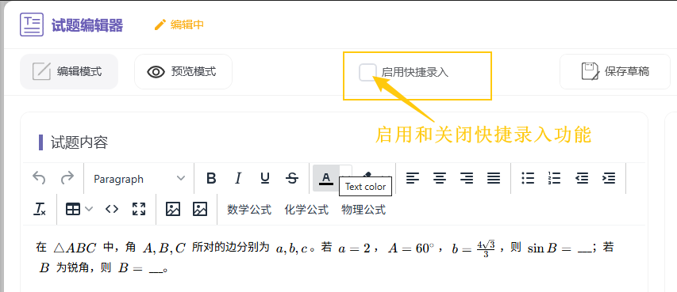

*图 5-18 启用和关闭快捷录入功能*

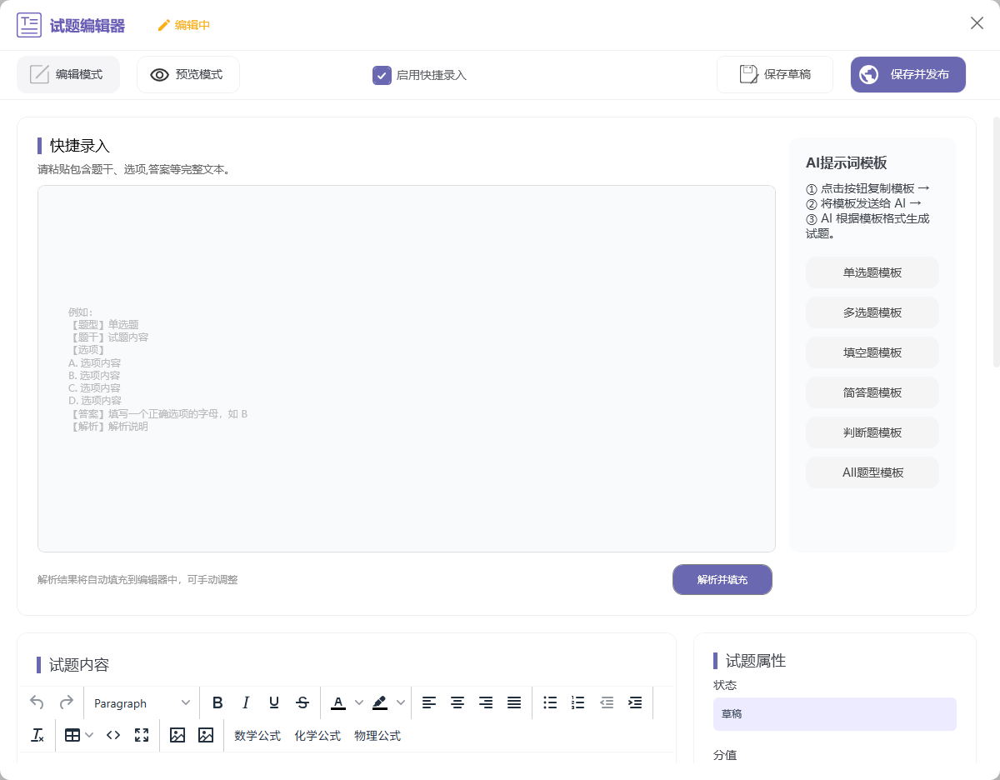

*图 5-19 快捷录入界面*

#### 5.5.2 文本格式

在快捷录入的文本框中，试题文本按“【标记】内容”的格式书写。文本框内置了单选题的示例，格式如下：

```text
【题型】单选题
【题干】试题内容
【选项】
A. 选项内容
B. 选项内容
C. 选项内容
D. 选项内容
【答案】填写一个正确选项的字母，如 B
【解析】解析说明
【难度】困难
【标签】高频、易错
【知识点】集合、多线程
```

| **标记**   | **含义**                                     |
|------------|----------------------------------------------|
| 【题型】   | 试题类型，如“单选题”                         |
| 【题干】   | 试题题干内容                                 |
| 【选项】   | 选项列表，每行一个选项，以“A.”“B.”等字母开头 |
| 【答案】   | 正确答案。单选题填写一个选项字母             |
| 【解析】   | 答案解析说明                                 |
| 【难度】   | 简单、中等、困难、极难、挑战                 |
| 【标签】   | 最多添加五个标签                             |
| 【知识点】 | 最多添加五个知识点                           |

#### 5.5.3 AI 提示词模板

快捷录入区域右侧提供“AI 提示词模板”，用于帮助用户借助外部 AI 工具生成符合格式的试题文本。使用步骤：

1.  点击右侧对应题型的模板按钮（单选题模板、多选题模板、填空题模板、简答题模板、判断题模板，或包含全部题型的“All 题型模板”），模板内容就会自动被复制。

2.  把模板发送给自己使用的 AI 工具，并告知严格按此提示词生成的试题。

3.  AI 按模板格式生成试题文本，将结果复制回快捷录入的文本框。

#### 5.5.4 解析并填充

文本准备好后，点击文本框下方的“解析并填充”。软件会按格式解析文本，并把题型、题干、选项、答案、解析自动填入编辑器对应位置。解析结果可以手动调整，确认无误后点击“保存并发布”（或先“保存草稿”）。

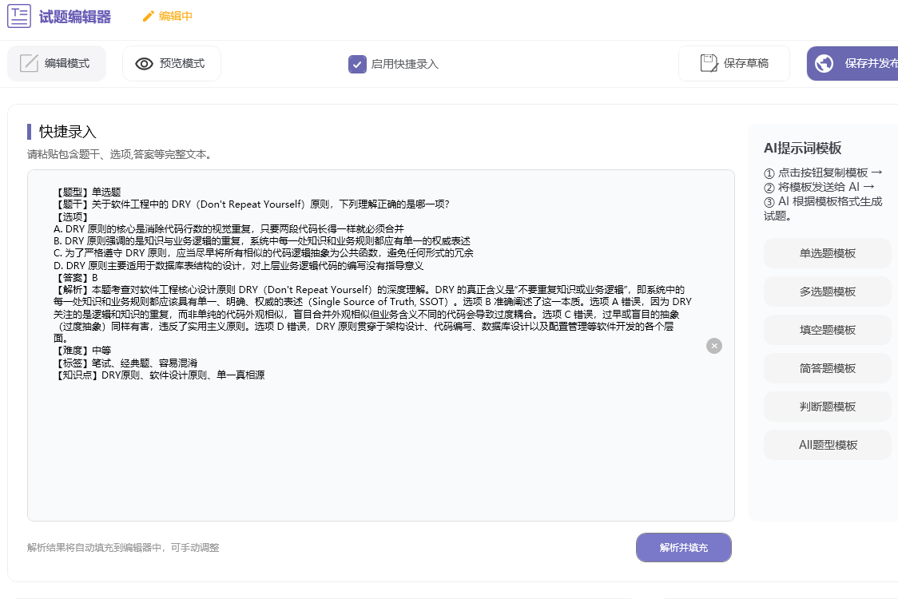

*图 5-20 解析并填充后的编辑器*

### 5.6 编辑、发布与删除试题

对已有试题，可使用以下操作按钮：

- 列表视图：点击该行“操作”列的“…”，弹出三个图标按钮。

- 卡片视图：卡片右上角直接显示三个图标按钮。

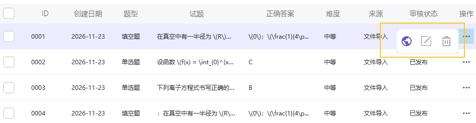

*图 5-21 列表视图中的试题操作按钮*

| **图标**           | **说明**                                                               |
|--------------------|------------------------------------------------------------------------|
| 地球图标           | 发布试题：将草稿状态的试题发布，发布后才能参与刷题（见下文“发布试题”） |
| 编辑图标（笔）     | 打开试题编辑器，修改该试题                                             |
| 删除图标（垃圾桶） | 删除该试题                                                             |

**发布试题**

试题分为“草稿”和“已发布”两种状态，只有已发布的试题才能参与刷题。通过批量导入添加的试题默认处于草稿状态，需要经过人工审核后，手动改为已发布状态。发布试题有以下两种方式：

- 列表视图：勾选试题前的复选框，单击鼠标右键，选择“选中的试题设置为「发布」”（见 5.7）。

- 卡片视图：点击卡片右上角的发布按钮（地球图标），更改该试题的状态。


*图 5-22 卡片视图中的发布按钮*

### 5.7 批量操作

在试题列表中勾选一个或多个试题前的复选框，然后在选中的行上单击鼠标右键，弹出批量操作菜单（图 5-23），包含以下三项：

- 删除选中的试题：一次删除所有勾选的试题。

- 选中的试题设置为「发布」：将勾选的试题批量改为已发布状态，发布后才能参与刷题。批量导入的试题默认为草稿，审核无误后可用此项一次性发布。

- 选中的试题设置为「草稿」：将勾选的试题改回草稿状态，改回后不再参与刷题。

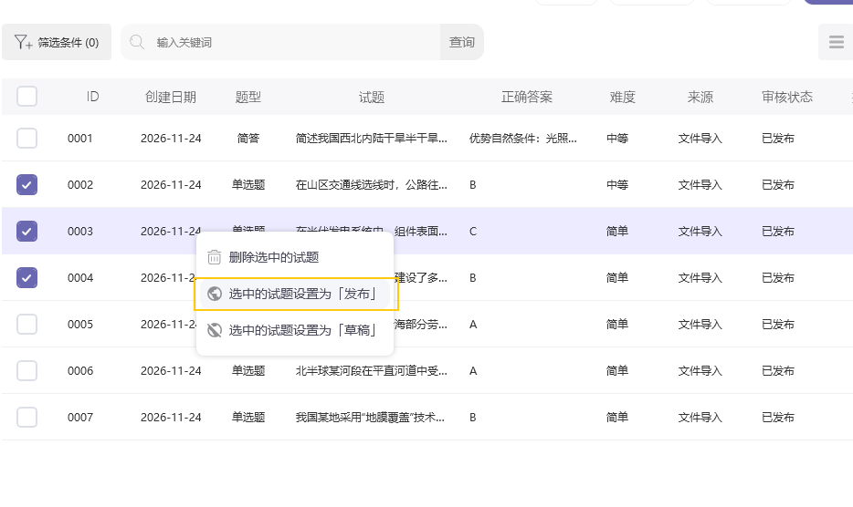

*图 5-23 试题列表中的批量操作菜单（以批量发布为例）*

## 第6章 试题导入与导出

### 6.1 批量导入试题

批量导入用于把已整理好的试题文件一次性导入到题库中。导入过程分为：选择文件、解析试题、确认并导入三个步骤，导入前可以预览解析结果，确认无误后再写入题库。

#### 6.1.1 打开导入窗口

导入的目标是“当前题库”，因此请先在“试题”页面左侧选中要导入的题库，再点击页面右上角的“批量导入”按钮，弹出“数据导入”窗口。窗口右上角的“导入到当前题库”标签显示本次导入的目标题库名称。


*图 6-1 试题页面右上角的“批量导入”按钮*

#### 6.1.2 文件格式要求与模板

“数据导入”窗口左侧的“文件格式要求”列出了各格式的要求，并提供模板或示例文件供下载。请先下载模板，按模板填写后再导入，可以避免格式错误。

| **格式** | **文件要求**                                                    | **说明**                                           |
|----------|-----------------------------------------------------------------|----------------------------------------------------|
| Excel    | .xlsx 格式；必须包含表头，字段顺序不限                          | 点击“下载 Excel 模板”获取模板                      |
| HTML     | .html 格式，UTF-8 编码；每道题须按指定的 HTML 格式存储          | 点击“下载 HTML 格式示例”获取示例                   |
| TXT      | .txt 格式，UTF-8 编码；每道题以【题型】开头，字段用【标签】标明 | 点击“下载 TXT 格式示例”获取示例                    |
| Markdown | .md 格式，UTF-8 编码；每道题须按指定格式存储，才能保证正确导入  | 点击“下载 Markdown 格式示例”获取示例，照着格式填写 |
| JSON     | .json 格式，UTF-8 编码；字段结构固定，适合 AI 生成和程序读取    | 点击“下载 JSON 格式示例”获取示例，照着格式填写     |

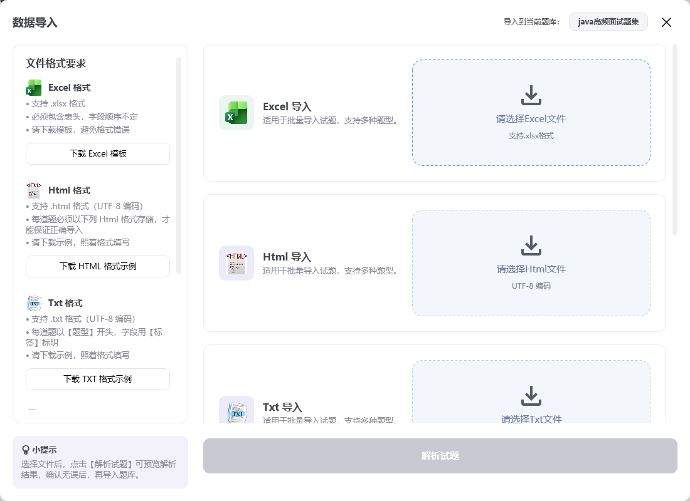

*图 6-2 “数据导入”窗口：文件格式要求与各格式的选择区域*

#### 6.1.3 选择文件

1.  在“数据导入”窗口右侧，找到与你的文件对应的格式卡片（Excel 导入、Html 导入、Txt 导入等）。

2.  点击该卡片中的虚线框，在弹出的文件选择窗口中选择文件。

选好文件后，对应格式的卡片会显示文件名、文件类型和大小，右侧的“X”可以移除已选文件。

一次只能选择一个文件。已选择文件后，其他格式的选择区域会变灰，并提示“已选择了文件，如需导入 Html 文件请先移除已选的文件”；需要换文件时，先点“X”移除。

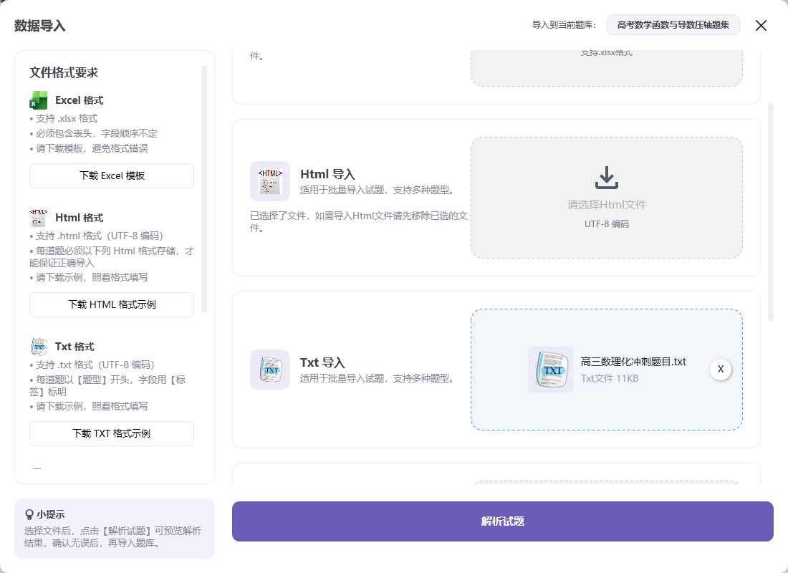

*图 6-3 已选择 TXT 文件后的导入窗口*

#### 6.1.4 解析试题与预览结果

选好文件后，窗口底部的“解析试题”按钮变为可用（未选择文件时为灰色）。点击后，软件按所选格式解析文件，并进入解析结果页面。窗口左下角的小提示说明了这一流程：先解析并预览结果，确认无误后，再导入题库。

解析结果页面分为左右两部分：

- 左侧：显示文件名与大小、解析状态（“已解析完成”）、试题总数、解析成功数、解析失败数和解析时间。“重新选择文件”可返回重选文件。

- 右侧：“解析结果”列表，上方有“成功”“失败”两个标签页，分别显示解析成功和失败的试题数量。列表列出序号、题型、题干和答案。

列表第一列是勾选框，默认全部选中，表头的勾选框用于全选或取消全选。可以取消勾选不想导入的试题，列表底部显示“已选 N 题”。窗口左上角的“返回”按钮可回到选择文件页面。

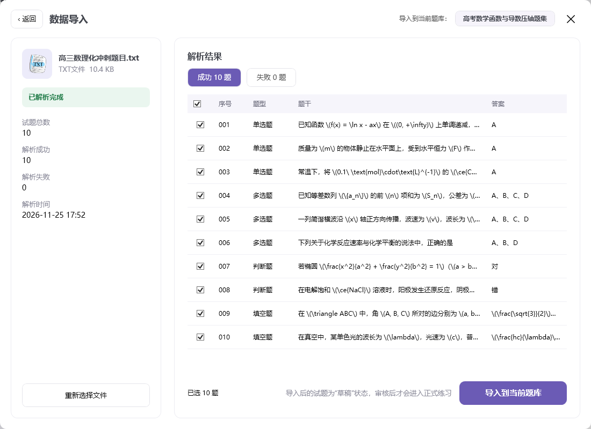

*图 6-4 解析结果页面*

#### 6.1.5 导入到当前题库

确认要导入的试题后，点击右下角的“导入到当前题库”。导入完成后，页面显示绿色的“成功导入 N 题”，左侧同时更新“已导入”的数量。点击“继续导入”可回到选择文件页面，再导入其他文件。

注意：导入后的试题默认为“草稿”状态，需要经过人工审核后，手动改为“已发布”状态，才能参与刷题。导入完成后，请在“试题”页面审核后再发布这些试题：在列表视图中勾选试题后右键设置为“发布”，或在卡片视图中点击发布按钮（见 5.7）。


*图 6-5 导入完成页面*

#### 6.1.6 解析失败的处理

如果文件中有试题无法解析，会显示在“失败”标签页下。可根据提示修改文件中对应的试题，然后点击“重新选择文件”再次导入。

### 6.2 导出试题

导出用于把题库中的试题保存为文件，便于传递、整理或迁移在其他设备上使用。导出的文件可以直接重新导入本软件。注意，题目中图片不会随题目一起导出。

#### 6.2.1 打开导出窗口

默认导出题库中所有题目。点击页面右上角的“批量导出”按钮，弹出“数据导出”窗口。窗口右上角的“当前题库”标签显示本次导出的题库名称。

#### 6.2.2 导出的内容

默认导出当前题库中所有题目。

#### 6.2.3 选择导出格式与存储位置

窗口右侧为各种导出格式的卡片：

| **格式** | **适用场景**                         | **保存为**          |
|----------|--------------------------------------|---------------------|
| Excel    | 查看、整理与编辑试题数据             | .xlsx 格式          |
| HTML     | 在浏览器中查看，保留题干和解析的排版 | .html（UTF-8 编码） |
| TXT      | 批量导出试题，题干和解析转为纯文本   | .txt（UTF-8 编码）  |
| Markdown | 在笔记软件中整理，格式转为 Markdown  | .md 格式            |
| Json     | 方便和AI交换或网络传递               | .json格式           |

1.  在需要的格式卡片中，点击“请选择存储位置”。

2.  在弹出的窗口中选择保存文件的文件夹。

3.  选好后，卡片显示所选的存储位置，右侧的“X”可移除重选。

一次只能选择一种导出格式。选择了存储位置后，其他格式的卡片会变灰，并提示“已选择了存储位置，如需导出其他格式请先移除已选的位置”。

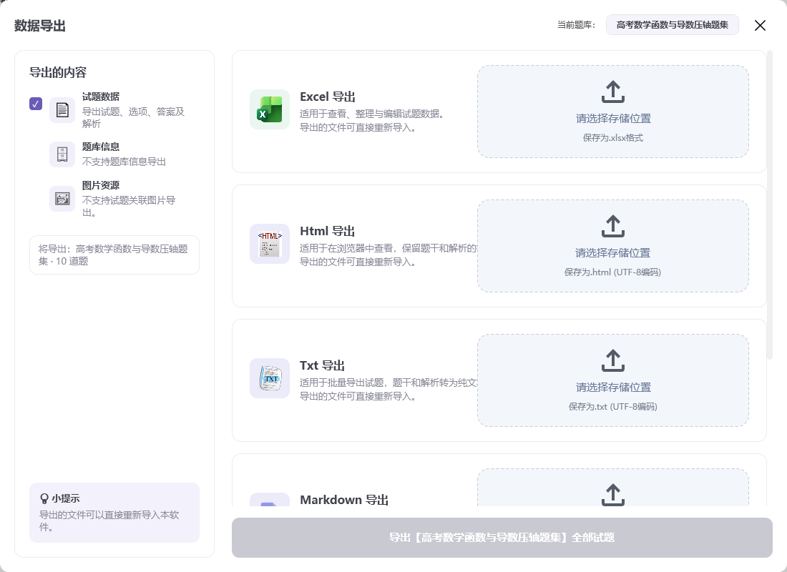

*图 6-6 “数据导出”窗口：导出的内容与各格式的存储位置选择*

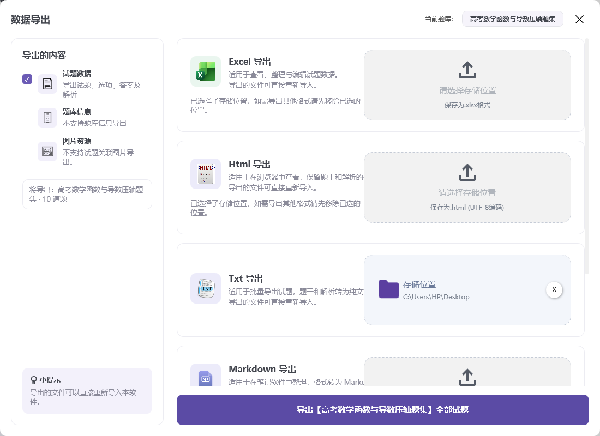

*图 6-7 已选择 TXT 格式的存储位置*

#### 6.2.4 执行导出

选好存储位置后，窗口底部的“导出【题库名】全部试题”按钮变为可用（未选择存储位置时为灰色），点击即开始导出。

导出完成后进入“导出结果”页面：左侧显示导出的文件名、“导出成功”状态、试题总数、保存位置和耗时；右侧显示“本次导出 N 道试题”，点击“打开所在文件夹”可直接打开文件所在的位置。左上角的“返回”可回到选择格式的页面，继续导出其他格式。


*图 6-8 导出结果页面*

## 第7章 刷题与答卷

刷题模块用于从题库中抽取试题组成试卷，并在线作答、交卷、查看答案与解析。点击导航栏“刷题”，进入“创建试卷”页面。

### 7.1 刷题流程简述

刷题分为三个步骤，在“创建试卷”页面自上而下依次完成：

1.  步骤一：选库。选择参与组卷的题库，默认全部题库的试题都作为备选试题。用户根据自己的组卷需求，选择对应的题库分类。选择题库分类后，必须选中至少一个有题目的题库。否则，后续步骤无法进行操作。

2.  步骤二：选题（可选）。设置选题条件，从已选题库中进一步筛选试题；可以直接采用默认设置。

3.  步骤三：组卷。选择刷题模式，设置试卷类型、难度和各题型的数量。

三步完成后，页面底部会显示参与组卷的试题数量，点击“开始刷题”即可进入刷题页面。

### 7.2 创建试卷

#### 7.2.1 步骤一：选库

“题库”下拉框用于按分类显示题库，选项包括“全部题库”“收藏夹”和用户自建的各个分类。页面下方以卡片形式显示对应范围内的题库，每张卡片包含：

- 题库封面和名称

- 试题数量（共 N 题）和所属分类标签

- 学习进度条及百分比（尚未练习时显示“尚未开始学习”）

点击卡片左上角的勾选框即可选中该题库，可同时选中多个题库。页面提示：选中的题库，其中的所有试题都作为备选试题。


注意：“学习进度”百分比的含义：指已练习过的试题数占题库总数的比例。

*图 7-1 “创建试卷”页面*

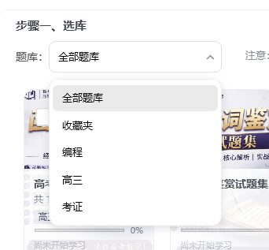

*图 7-2 “题库”下拉框*

#### 7.2.2 步骤二：设置选题条件

点击“设置选题条件”，打开“筛选条件设置”窗口，用于从已选中的题库里筛选试题。该步骤可选，可以直接采用默认设置。窗口提示：以下不勾选的单选框或多选框，将不作为筛选条件，不影响步骤一的筛选结果。可设置的条件如下：

| **条件**       | **选项**                                   | **说明**                   |
|----------------|--------------------------------------------|----------------------------|
| 未练习过的     | 不限、未做过的题、近30天录入               | 按是否做过、录入时间筛选   |
| 已练习过试题   | 不限、错题                                 | 只练习做错过的题           |
| 个人标记的试题 | 重点、易错、疑难（可多选）                 | 练习时由用户自己标记的试题 |
| 试题编辑状态   | 草稿、已发布                               | 按试题状态筛选             |
| 知识点         | 按题库分组列出知识点及对应的试题数，可多选 | 只抽取所选知识点下的试题   |
| Tag            | 列出标签及对应的试题数，可多选             | 只抽取带有所选标签的试题   |

“知识点”和“Tag”区域右上角有“全选”“全取消”按钮。设置完成后点击“应用筛选”；“重置”恢复为默认设置。

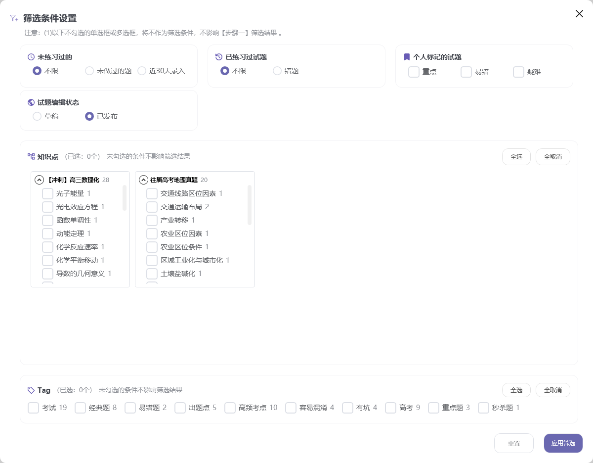

*图 7-3 “筛选条件设置”窗口*

截图里“试题编辑状态”选中的“已发布”是默认值。批量导入题库中的试题，默认为 “草稿”的状态，不会进入刷题，只有当这些试题审查无误后，重新发布（见 5.7、6.1.5），才会进入刷题池。

#### 7.2.3 步骤三：组卷

“模式”下拉框用于选择刷题模式（截图中为“练习模式”）。点击右侧的“组卷设置”，打开“组卷配置”窗口，先选择“试卷类型”：

- 标准试卷：只需选择试卷难度（简单、中等、挑战、任意），由软件按默认规则抽题。点击“应用设置”生效，“默认设置”可恢复默认。


*图 7-4 “组卷配置”：标准试卷*

- 自定义试卷：自行指定各题型的题量。

1.  在“试卷中的题型”中勾选需要的题型：单选题、多选题、判断题、填空题、简答题。

2.  在“题型的难度与数量/卷”中，为每种题型按难度（简单、中等、困难、极难、挑战）分别填写题数，右侧“共 N 题”自动汇总；勾选“任意难度”则不区分难度。

3.  标题处显示“每一卷总计”的题数。

4.  点击“应用设置”生效。

每种题型的数量有上限：单选题、多选题、判断题各不超过 20 题，填空题、简答题各不超过 10 题。

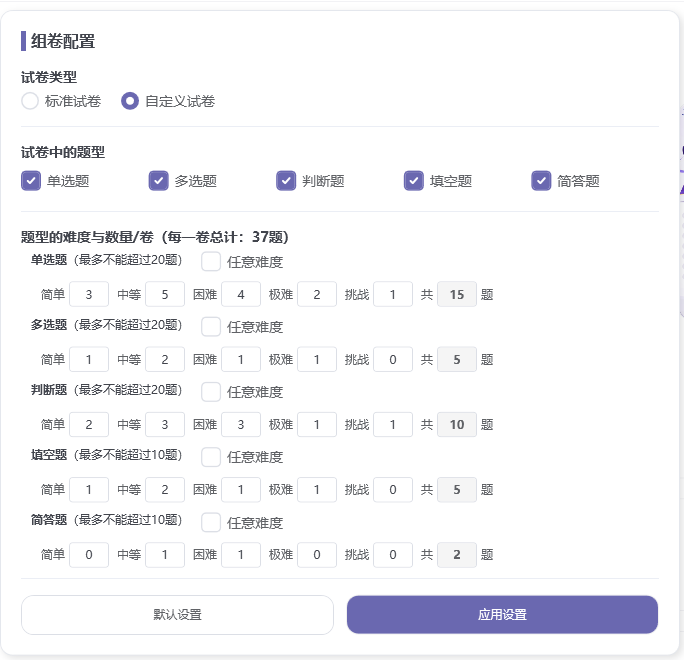

*图 7-5 “组卷配置”：自定义试卷*

#### 7.2.4 开始刷题

页面底部的状态栏显示：已选择 N 个题库，总共 N 题，符合条件共 N 题（若小于设置的抽题数量，则以此为准）。“全选”“清空”用于快速选中或取消全部题库。确认无误后，点击“开始刷题”进入刷题页面。


*图 7-6 底部状态栏*

### 7.3 答题

进入刷题页面后，页面分为左侧的作答区和右侧的练习面板。

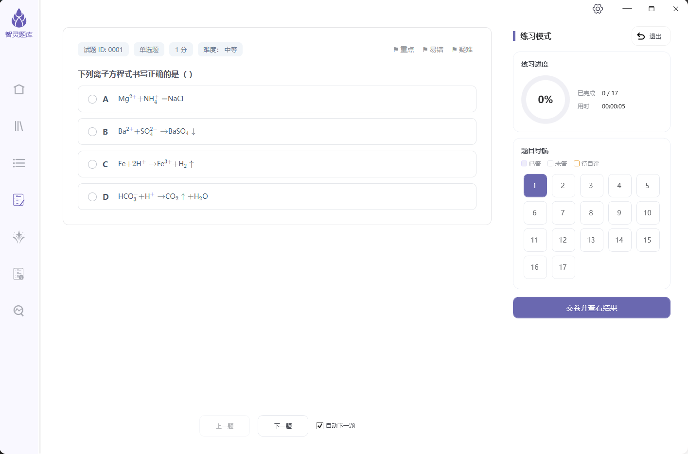

*图 7-7 刷题页面：单选题*

#### 7.3.1 作答区

作答区顶部的标签显示试题 ID、题型、分值和难度，右上角可对试题打“重点”“易错”“疑难”标记。标记后的试题，可在以后的选题条件中按“个人标记的试题”筛选（见 7.2.2）。

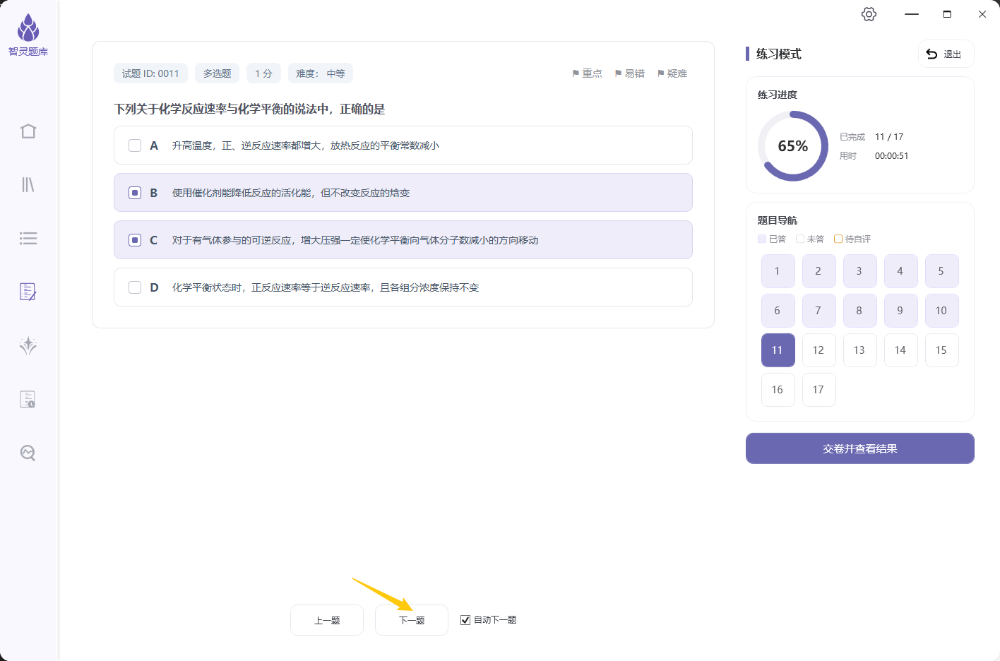

*图 7-8 刷题页面：多选题（第 11 题）*

#### 7.3.2 练习面板

- 练习进度：环形图显示已完成的百分比，旁边显示“已完成 N / M”和用时。

- 题目导航：以题号网格显示全部试题，用不同颜色区分“已答”“未答”“待自评”，当前题以深色突出。点击题号可直接跳到该题。

- 退出：点击右上角“退出”离开刷题页面。

- 交卷并查看结果：作答完毕后点击，见 7.4。

#### 7.3.3 切换试题

作答区底部有“上一题”“下一题”按钮，在第一题时“上一题”不可用，在最后一题时“下一题”不可用。勾选“自动下一题”后，作答后部分题目（单选、多选、判断）会自动进入下一题，填空题和简答题还是需要手动填写完成后点击“下一题”，才能进行题目切换。

### 7.4 交卷与查看结果

作答完毕后，点击右侧的“交卷并查看结果”，弹出“交卷确认”提示：“确定要交卷吗？交卷后将不能再修改答案。”点击“是”完成交卷，点击“否”返回继续作答。


*图 7-9 “交卷确认”提示*

交卷后，页面显示作答结果：

- 题目导航中，每个题号后标出对错：“√”表示答对，“×”表示答错。

- 点击题号，可查看该题的答案与解析；点击“正确答案与解析”可展开或收起内容。

- “交卷并查看结果”按钮变为“交卷成功”。

- 因为是练习模式，因此不会出现分数。

- 提交后的答卷会进入答卷库，统一管理。同时，保存的答卷结果也会刷新**步骤一** 练习进度。

简答题没有标准的自动判分方式：交卷后页面提示“请对照下面的参考答案，自己评判一下”，用户对照参考答案，点击“我答对了”或“我答错了”进行自评。自评之前，该题在题目导航中显示为“待自评”。

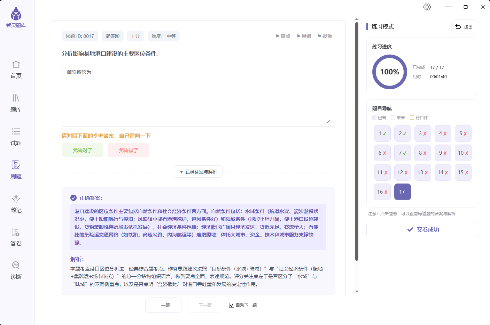

*图 7-10 交卷后的结果与简答题自评*

### 7.5 答卷记录

每次练习交卷后，试卷和作答情况会保存下来。点击导航栏“答卷”，进入“答卷记录”页面。所有刷题完成的答卷都在这里统一管理，可以按条件查询，也可以删除。

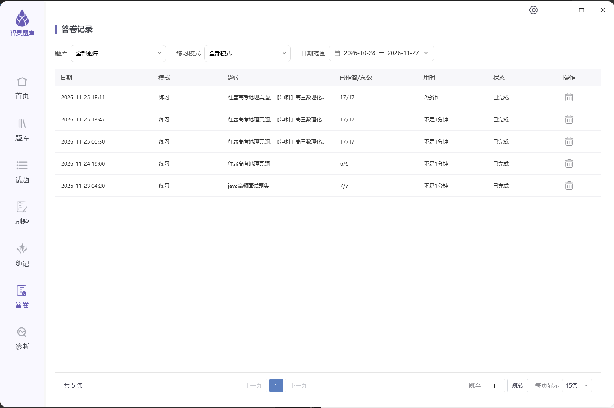

*图 7-11 答卷记录页面*

#### 7.5.1 答卷列表

页面中部的列表按行显示每一份答卷，各列含义如下：

| **列**      | **说明**                                                         |
|-------------|------------------------------------------------------------------|
| 日期        | 答卷的日期和时间                                                 |
| 模式        | 本次刷题所用的模式，如“练习”                                     |
| 题库        | 本次组卷所用的题库；包含多个题库时以顿号连接，名称过长时省略显示 |
| 已作答/总数 | 已作答的试题数与试卷总题数，如“17/17”                            |
| 用时        | 本次刷题所用的时间                                               |
| 状态        | 答卷状态，如“已完成”                                             |
| 操作        | 垃圾桶图标，用于删除该份答卷                                     |

#### 7.5.2 查询答卷

页面上方提供三个查询条件，可单独使用，也可组合使用：

- 题库：从下拉列表中选择题库，只查看该题库的答卷；选择“全部题库”则不限题库。

- 练习模式：从下拉列表中选择刷题模式；选择“全部模式”则不限模式。

- 日期范围：点击日期框，选择起止日期，只查看该时间段内的答卷。

列表底部显示符合条件的答卷总数（如“共 5 条”）。答卷较多时，可点击“上一页”“下一页”翻页，也可在“跳至”框中输入页码后点击“跳转”；点击右侧“每页显示”可设置每页显示的条数。

#### 7.5.3 删除答卷

点击答卷所在行“操作”列的垃圾桶图标，可删除该份答卷。删除答卷会影响刷题页面步骤一的卡片上的所显示的练习进度。

## 第8章 随记

随记用于临时存放尚未整理的重点题、错题和重点知识，也可以随手记下思路、灵感、构思等。每条随记可以包含文字和图片，并可设置重要程度。

点击导航栏“随记”进入随记页面。页面上方左侧是页面说明，右侧依次是“添加记录”按钮和关键字搜索框；下方以卡片形式排列已有的随记。每张随记卡片包含：

- 随记的文字内容，显示在卡片顶部。

- 图片缩略图。图片较多时，只显示前几张，其余以“+1”等数字提示。

- 创建时间与重要程度（以进度条显示）。

- 右下角的“编辑”（笔）和“删除”（垃圾桶）图标。

随记较多时，可向下浏览，列表末尾显示“没有更多了”。

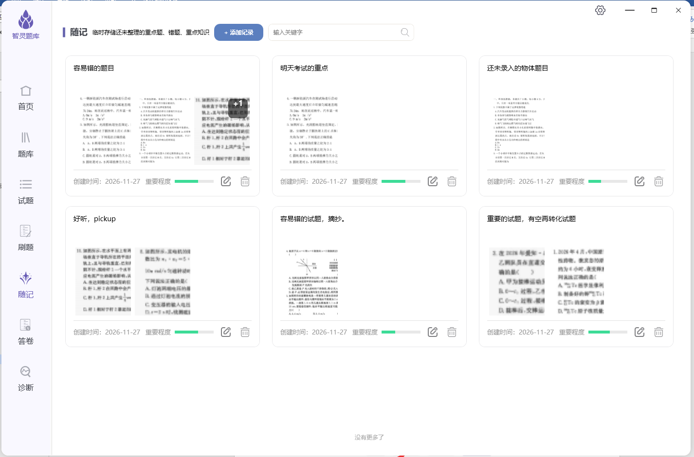

*图 8-1 随记概览*

### 8.1 添加随记

1.  点击页面上方的“+ 添加记录”按钮，弹出记录窗口（图 8-2）。

2.  在文字框中输入要记录的内容，例如思路、灵感、构思、知识点等。

3.  如需添加图片，点击文字框右侧的相机图标。

4.  在窗口中部的条形上点击相应位置，设置这条随记的重要程度。设置后的重要程度会显示在随记卡片上。

5.  点击“记录”，随记保存并显示在随记页面中。

点击记录窗口右上角的“×”可关闭窗口。

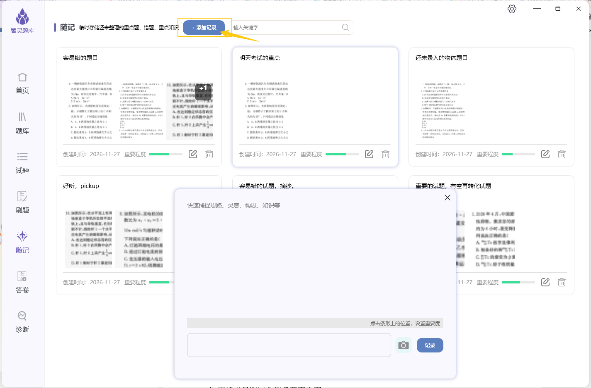

*图 8-2 点击“+ 添加记录”后弹出的记录窗口*

### 8.2 查看、编辑与删除

- 查看：双击随记卡片，查看该条随记的内容。

- 编辑：点击卡片右下角的“编辑”图标，修改该条随记。

- 删除：点击卡片右下角的“删除”图标，删除该条随记。

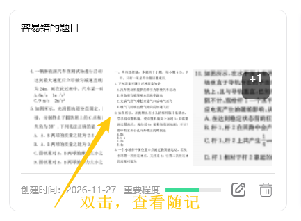

*图 8-3 双击随记卡片查看随记*

### 8.3 搜索随记

在页面右上方的搜索框中输入关键字，即可查找包含该关键字的随记。

## 第9章 首页数据概览与数据诊断

### 9.1 首页数据概览

“首页”集中展示软件中的数据统计。页面右上角的“指定日期范围”可以限定统计的时间段。


*图 9-1 首页：数据概览、试题概览与用时概览*

#### 9.1.1 数据概览

页面顶部四张卡片分别显示题库总数、试题总数、答卷总数和随记总数，并在卡片下方显示“今日新增”数量。

#### 9.1.2 试题概览

- 题型分布：环形图显示单选题、多选题、判断题、填空题、简答题各自的占比与数量。

- 试题增长趋势：折线图显示指定日期范围内每天新增的试题数。

#### 9.1.3 用时概览

- 用时：按月显示累计练习用时（小时）。

- 用时占比前十：以饼图显示练习用时最多的题库及其占比。

### 9.2 数据诊断

点击导航栏“诊断”，进入“试题和题库诊断”页面。该模块对试题和题库中的各个项目（Item）进行诊断，找出尚未完善的试题和题库录入，并准确定位到需要修改的项目，用户可据此逐项修正。

目前可以检查的内容包括：

| **检查项**                                   | **说明**                         |
|----------------------------------------------|----------------------------------|
| 缺少知识点                                   | 试题没有设置知识点               |
| 缺少解析                                     | 试题没有填写答案解析             |
| 答案无效（单选 / 多选 / 判断 / 填空 / 简答） | 对应题型的答案配置不完整或不合法 |
| 题型无效                                     | 试题的题型数据异常               |
| 题库缺少封面                                 | 题库没有设置封面图片             |

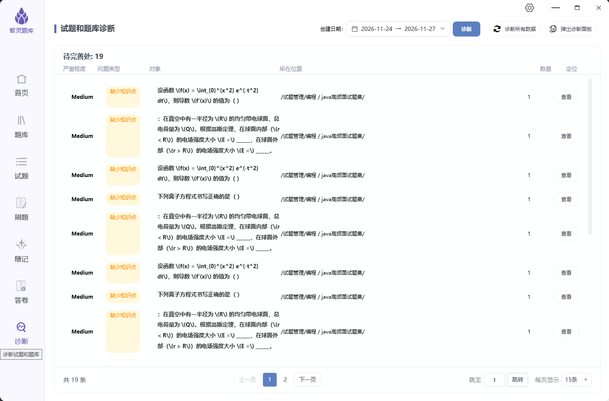

*图 9-2 试题和题库诊断页面*

#### 9.2.1 选择诊断范围

页面右上方提供两种诊断方式：

- 按创建日期范围诊断：点击“创建日期”后的日期框，选择起止日期，再点击“诊断”，只诊断创建日期在该时间段内的题库和试题。


*图 9-3 选择创建日期范围并点击“诊断”*

- 诊断所有数据：点击“诊断所有数据”，对全部题库和试题进行诊断。数据量较大时，全量诊断需要一定时间。


*图 9-4 “诊断所有数据”按钮*

#### 9.2.2 查看诊断结果

诊断完成后，页面上方显示“待完善处”的总数，下方列表中的每一行是一处待完善的问题，各列含义如下：

| **列**   | **说明**                                                                 |
|----------|--------------------------------------------------------------------------|
| 严重程度 | 该问题的严重程度，如 Medium                                              |
| 问题类型 | 问题的类别，如“缺少知识点”                                               |
| 对象     | 存在问题的试题（显示题干原文）或题库                                     |
| 所在位置 | 问题所在的位置，如“/试题管理/编程 / java高频面试题集/”，即所属分类和题库 |
| 数量     | 该处问题的数量                                                           |
| 定位     | “查看”按钮，用于定位到需要修改的项目                                     |

列表底部显示问题总数（如“共 20 条”）。问题较多时，可点击“上一页”“下一页”或页码翻页，也可在“跳至”框中输入页码后点击“跳转”，并可通过“每页显示”设置每页的条数。

注意：“对象”列显示的是试题题干的原始文本，其中的数学公式会以公式代码的形式显示（见图 9-5）。这是正常的公式代码，不是错误，也不影响刷题页面的公式显示。

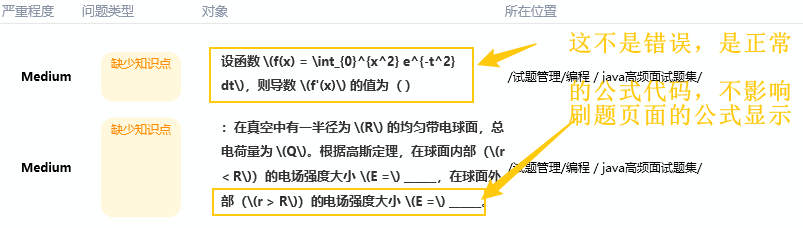

*图 9-5 “对象”列中的公式代码（正常显示，不是错误）*

#### 9.2.3 定位问题

找到待完善的项目后，有两种方式可以定位到需要修改的位置：

- 点击“查看”按钮：在诊断页面的列表中，点击某一行“定位”列的“查看”，软件会跳转到对应的试题或题库，定位到需要修改的项目。


*图 9-6 “查看”按钮*

- 使用诊断面板：点击诊断页面上方的“弹出诊断面板” ，诊断面板会悬浮显示在软件界面上。在面板的列表中点击要定位的项目，页面中对应的项目会高亮显示，高亮处就是需要修改的位置。

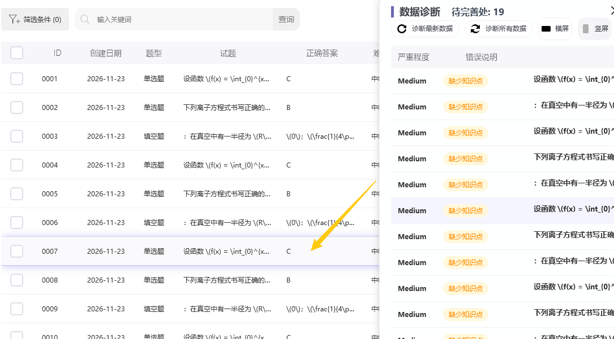

## 第10章 设置与数据安全

### 10.1 数据备份

备份功能把题库数据保存为一个备份文件，用于防止硬盘损坏等情况导致数据丢失。

点击软件右上角的设置按钮（齿轮图标），在弹出的菜单中选择“备份和还原”（图 10-1），即可打开“数据备份和还原”窗口。窗口分为上下两部分：上方是“导入备份”（用于还原），下方是“备份”（图 10-2）。

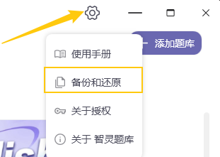

*图 10-1 设置菜单中的“备份和还原”*

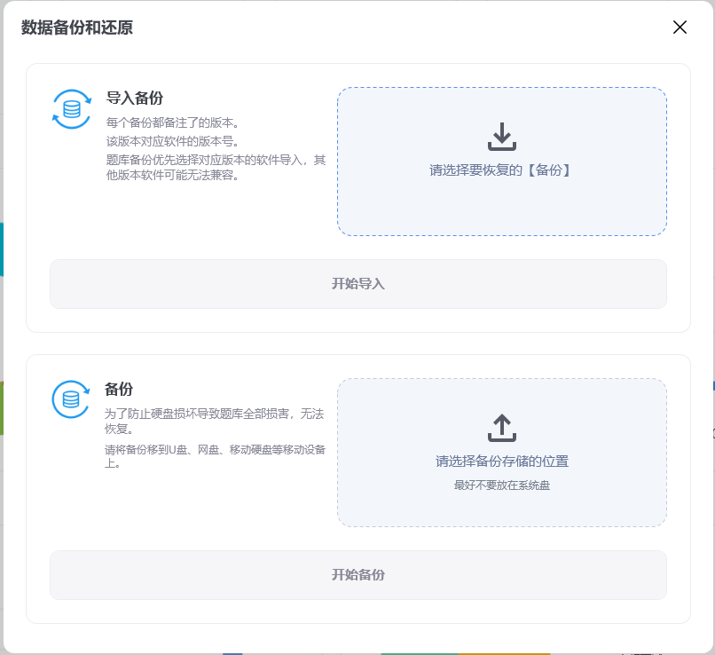

*图 10-2 数据备份和还原窗口*

备份步骤如下：

1.  在“备份”区域中，点击“请选择备份存储的位置”，选择用于保存备份文件的文件夹。

2.  选定后，该区域显示所选的存储位置（如 C:\Users\HP\Desktop）；如需重新选择，点击右侧的“X”（图 10-3）。

3.  点击“开始备份”。

4.  备份完成后，显示“备份结果”页面（图 10-4），点击“返回”可回到备份和还原窗口。


*图 10-3 选择备份存储位置后的窗口*

“备份结果”页面显示：备份文件的名称（如“智灵题库 V1.0.0 (3).bak”，名称中包含软件版本号）、备份内容（试题、题库、随记，以及相关的图片等）、保存位置和耗时；点击“打开所在文件夹”可直接打开备份文件所在的位置。相关的备份版本只能导入对应版本的软件中。

备份内容包括软件的数据库（其中含有答卷记录），以及试题、题库、随记相关的图片。

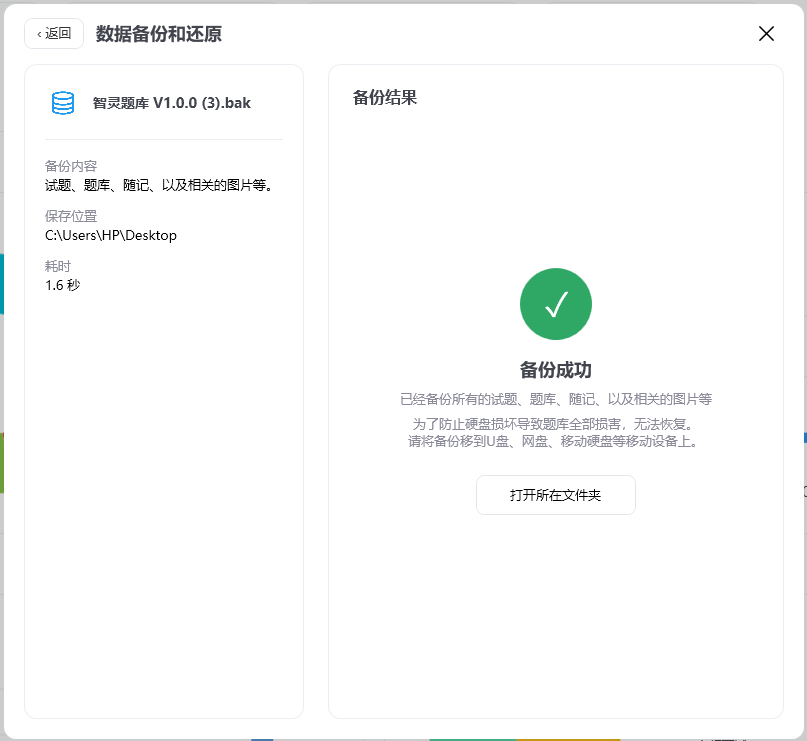

*图 10-4 备份成功*

注意：为了防止硬盘损坏导致题库全部损坏、无法恢复，请将备份文件移到 U 盘、网盘、移动硬盘等移动设备上。

### 10.2 数据还原

“导入备份”区域用于从备份文件恢复数据。每个备份文件都标注了版本，该版本对应软件的版本号。恢复时请优先选择对应版本的软件导入，其他版本的软件可能无法兼容。

还原步骤如下：

1.  在“导入备份”区域，点击“请选择要恢复的【备份】”，选择备份文件（.bak）。

2.  点击“开始导入”，开始还原数据。

选择备份文件后，窗口显示备份文件的名称、大小和备份日期（图 10-5）；如选错了，点击右侧的“X”重新选择。此时“开始导入”按钮变为可点击状态，下方的“备份”区域变灰，暂不可用。


*图 10-5 选择备份文件后的还原窗口*

注意：还原会覆盖现有数据，请确认后再操作；如有需要，可先备份当前数据。

### 10.3 数据存放与隐私

软件的数据保存在用户本机，不上传到服务器。用户可随时通过备份功能导出数据。

### 10.4 授权信息

点击软件右上角的设置按钮（齿轮图标），在弹出的菜单中选择“关于授权”，即可打开授权信息窗口。

## 第11章 常见问题

| **问题**                       | **解答**                                             |
|--------------------------------|------------------------------------------------------|
| 启动时提示缺少 WebView2 运行时 | 按提示打开微软官方下载页面安装，安装后重新启动软件。 |
| 找不到桌面图标                 | 应用安装后在“开始”菜单中，可拖到桌面或固定到任务栏。 |
| 导入试题提示文件结构不符       | 对照导入模板检查文件，修正后重新导入。               |
| 担心数据丢失                   | 使用“备份”功能定期导出数据，换电脑时通过“还原”导入。 |
| 试用到期后怎么办               | 在 Microsoft Store 购买后即可继续使用。              |
| 如何联系作者                   | 邮箱：zhilingtiku@foxmail.com                        |

## 附录 版本说明

| **版本** | **日期** | **说明**     |
|----------|----------|--------------|
| V1.0.0   | 2026-11  | 首个正式版本 |
